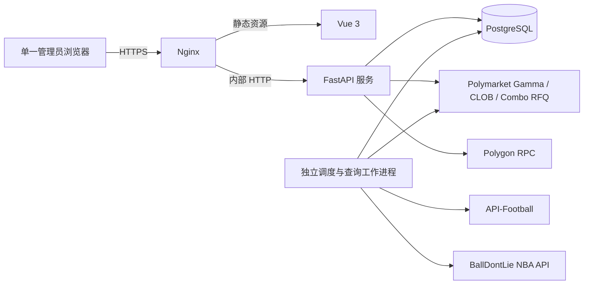

# PolySports 系统架构

本文是第一阶段的设计文档，描述拟实现的系统，不表示功能已经开发或通过真实资金验证。详细数据表、内部接口、页面和分阶段验收分别在后续 `DATABASE.md`、`API.md`、`UI.md` 和 `DEVELOPMENT_PLAN.md` 中定义。

## 1. 目标与现有项目关系

PolySports 是本仓库内独立开发、独立部署的个人足球与 NBA 赛事及 Polymarket 交易系统。建议源代码置于 `polysports/`，使用独立的 Python 环境、Vue 构建、PostgreSQL 数据库、systemd 服务和配置；本文及后续交付文档位于仓库根目录。现有 Flask Dashboard、其数据和启动方式保持独立，不作为 PolySports 的运行依赖。

现有 `polymarket_autotrader/execution.py` 已实现部分单场 CLOB 规则校验、钱包配置和错误处理，可作为设计与测试参考；在复用代码前须检查其依赖、线程安全、异常和协议兼容性，不能将已有模拟测试视为真实资金验证。现有代码不具备本文所需的 Combo RFQ 完整流程。

## 2. 系统结构与技术选型

- **前端**：Vue 3、Vue Router 和 TypeScript；构建为静态文件，由 Nginx 提供。足球与 NBA 分设赛事中心；共用市场匹配、交易、关注、历史及系统状态组件。
- **服务端**：Python、FastAPI、Pydantic、SQLAlchemy 2.x、Alembic；使用明确的服务层和数据提供商适配器。所有外部请求均设置超时、限流及可观测的失败状态。
- **数据**：PostgreSQL 是赛事、关注、任务截止时间、订单意图、对账和审计记录的持久事实来源。金额、价格、份额使用定点十进制；禁止用浮点比较交易金额。
- **后台任务**：单独的 Python worker，以数据库持久任务、事务锁和租约领取到期工作；进程内定时器仅用于唤醒，不是任务真相来源。无需额外引入 Redis 或独立队列服务。
- **部署**：Nginx 终止 HTTPS；FastAPI 与 worker 作为不同的 systemd 单元运行，数据库独立备份。配置通过环境变量和权限受限的服务端密钥文件加载，配置说明集中维护。

## 3. 数据源与赛事身份

足球由 API-Football 适配器获取赛程及赛事状态；NBA 由 BallDontLie NBA API 适配器获取。适配器负责认证、分页、限流、时间解析、来源状态转换和错误分类。BallDontLie 文档要求 API key；两家 API 的订阅权限、覆盖范围、队徽字段及额度应在接入和部署时实际验证。没有权限、数据缺失或请求失败时记录可见错误，不填造赛事、赛果或价格。

每场比赛按**数据源 + 原始赛事 ID**唯一识别，原始 ID、球队、联赛、开赛时间、状态和更新时间均保留；同步以唯一约束和事务 upsert，保留历史。若延期或取消，保留原赛事 ID、记录状态变化及时间变更，重新评估尚未到期的关注计划；状态不明确时不得视为完赛。

球队实体保存来源标识、来源名称、中文名称、别名和来源队徽 URL。NBA 和足球常见球队的中文名由可核验的映射维护，并允许管理员补充。第三方并不保证覆盖所有中文名称：未确认中文名时展示来源原名及“待补充”标记，避免编造；队徽缺失时显示占位图，保留缺失状态。时间统一以 UTC 存储和计算，界面按固定 UTC+8 显示并标明时区。

Polymarket 事件与体育数据赛事分别拥有各自的 ID。映射采用来源球队 ID、球队别名、赛事类别、主客关系和开赛时间等证据；记录候选和确认结果。系统只对经过可靠匹配或管理员确认的映射启用交易，不把名称相近或多场候选中的第一条当作确定结果。Gamma 市场 ID、链上 condition ID、outcome 资产 ID 及 Combo 腿标识分别保存，不混用。

## 4. 同步与关注任务

默认每天 **UTC 00:00 和 08:00** 启动独立的足球和 NBA 同步，读取从任务实际开始时起未来 36 小时的赛事，并在采集后按时间窗口过滤。调度时间作为配置持久化、允许修改，并以 UTC 明确展示。同步使用运行记录、来源 ID 唯一键和幂等 upsert；部分分页失败标为失败或部分失败，不以不完整结果覆盖完整数据，也不删除未返回的历史赛事。

用户提交单场订单或接受 Combo 报价前，将相应赛事的关注记录和交易意图在同一数据库事务中写入；一次 Combo 对每条腿对应的赛事建立关注。重复关注不产生重复记录。失败、拒绝或结果未知也保留意图与关注，供审计和后续处理；不把“已提交”当成“已成交”。

关注赛事首次常规赛果查询的截止时间为：

| 赛事 | 首次截止时间 | 未完赛后的间隔 |
| --- | --- | --- |
| 足球 | 当前有效开赛时间 + 120 分钟 | 10 分钟 |
| NBA | 当前有效开赛时间 + 159 分钟 | 3 分钟 |

每次查询结束后持久记录结果、下次截止时间、尝试次数和错误；数据源暂不可用时记录失败并遵守其限流和重试要求。只有来源明确确认完赛，才停止该赛事常规轮询；延期、取消或中断要按映射后的状态单独处理，不能当作已完赛。补正或管理员操作应保留可审计记录。

数据库保存 `due_at`、状态、租约到期时间及幂等标识。worker 只领取 `due_at <= 当前 UTC 时间` 的任务，通过事务锁防止多个 worker 重复领取；崩溃任务的租约到期后可恢复。重启时只处理已经到期的任务；未到期任务绝不提前执行。下次查询以实际结果和当前赛事有效开赛时间重新计算，避免提前或无限追赶已错过的轮询。具体表、锁和任务重试上限在数据库与开发计划阶段进一步明确。

## 5. 交易与钱包

### 5.1 账户和签名

使用官方 `polymarket-client` 及其支持的 Polymarket 钱包类型，区分签名者地址、账户钱包地址、CLOB 凭证和可选 Builder 凭证；只接受明确配置且经 SDK 核对的钱包。私钥只驻留受限的服务端密钥环境，不写入数据库、浏览器、URL、日志或仓库；生产进程使用独立系统用户和最小文件权限。连接现有钱包时不自动部署钱包或执行链上授权；余额和授权不足时报告真实原因。

在已合规部署和使用的前提下，按 Polymarket 官方接口检查交易可用性和账户限制；受限或无法确认时不发送新订单。该检查不能替代用户对其所在地、账户和服务条款的独立判断。

### 5.2 单场订单

读取真实市场和订单簿，展示所选赛事、outcome、买卖方向、限价、份额、预计金额及可能费用，用户确认后签名提交。提交前再次校验市场映射、是否可交易、余额/授权和订单簿增量与最小数量；价格或市场已变化且不再满足确认条件时要求重新确认。采用官方 SDK 的 CLOB 流程，保留现有 OpenSpec 对订单约束、钱包、状态及 425/post-only 处理的要求。

订单状态区分待提交、已接受/挂单、部分成交、全部成交、拒绝、已撤销及未知；以交易所订单、成交或链上确认作为依据，不能将请求成功或订单 ID 推定为成交。若网络中断导致请求结果不明，保存请求/订单标识并对账，不能盲目再次提交；若无法可靠确定结果，保持未知并提示人工处理。

### 5.3 Combo 组合订单

Combo 不是多笔单场订单的简单批量提交。系统需检查每一腿是否支持 Combo，按官方 RFQ 流程建立询价、接收真实可执行报价、展示全部组合腿、报价、费用和到期时间，在报价有效期内取得用户确认并签名接受，然后跟踪执行和结算。无报价、报价过期、maker 拒绝、执行失败与未知均为独立状态，不虚构成功或收益。

官方 Builder 集成示例需要 Builder API key、账户签名和 Deposit Wallet 等配置；实际账户、市场、权限、地域和产品可用性须在集成时验证。Combo 需以稳定 RFQ ID 恢复并核对状态，接受请求结果不明时不得创建新的报价或重复执行来掩盖未知状态。单场与 Combo 的实现及测试必须分别覆盖。

## 6. 管理、统计与安全访问

单一管理员通过 HTTPS 登录；密码哈希存储，提供会话过期、登录频率限制、CSRF 防护及安全 Cookie；部署说明包含 TLS 更新和反向代理配置。API 密钥集中由环境变量或受限密钥文件提供，前端不接收服务端密钥；配置页面仅显示脱敏状态和允许修改的非秘密参数。日志包含任务类型、来源、时间、结果、错误类别与关联 ID，禁止输出凭证、私钥和签名原文。

历史统计基于持久化赛事和已核实订单/成交，区分真实交易、待确认及明确标记的测试记录，不把未成交订单算作收益。Excel 与 CSV 导出支持筛选、字段说明及 UTC+8 显示，避免将用户输入作为电子表格公式执行。系统状态页面展示各数据源、调度进程、下一次任务、最近同步及失败信息；无权限或请求失败显示实际状态。

## 7. 测试与交付策略

所有模拟数据必须在测试代码、测试数据库和界面中明确标识；测试默认禁止真实订单。设计文档阶段分别进行覆盖性和一致性审查；实现阶段依次开展单元测试、数据库迁移/并发测试、第三方协议契约测试、调度重启测试、前后端集成及端到端测试。组合 RFQ 包含无报价、过期、拒绝、超时及恢复对账测试。真实数据只读联调需有效凭证和适当额度；实际资金交易的端到端验证需用户在目标账户与环境中单独安排，不能由模拟通过推断成功。

交付包括完整源码、版本化迁移、测试、环境变量样例、Nginx 配置、systemd 单元、备份恢复脚本和 `DEPLOY.md`。每个阶段先验证，再按当前协作约定提交推送并等待用户确认下一阶段；整体工作未完成前保留 OpenSpec 活动变更，不提前归档。

## 8. 主要依据

- [Polymarket 单场下单](https://docs.polymarket.com/trading/place-orders)：市场标识、订单簿约束和订单生命周期。
- [Polymarket Combo 工作方式](https://docs.polymarket.com/trading/combos/overview)：组合腿、询价与报价接受流程。
- [Polymarket Combo Builder 接入](https://docs.polymarket.com/trading/combos/builders)：Builder 凭证、询价状态与恢复。
- [Polymarket 交易地域限制接口](https://docs.polymarket.com/api-reference/geoblock)：下单前的可用性检查。
- [BallDontLie NBA API](https://docs.balldontlie.io/) 和 [API-Football 文档](https://www.api-football.com/documentation-v3)：赛事数据来源及接入限制。
