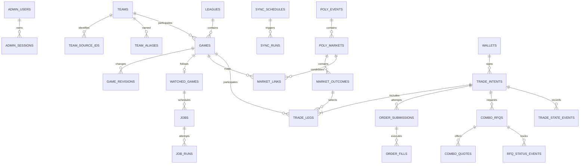

# PolySports 数据库设计

本文是第二阶段的设计契约，数据库尚未创建，DDL 尚未作为 Alembic 迁移执行。以 [ARCHITECTURE.md](ARCHITECTURE.md) 和 OpenSpec 变更 `build-polysports` 为依据；具体迁移版本将在编码阶段建立，并以 PostgreSQL 集成测试确认。除有标记外，本设计适用于独立的 PostgreSQL 数据库，不依赖原有 Dashboard。

## 1. 约定

- 目标 PostgreSQL 15 或更新版本；表统一位于专用数据库的 `public` schema；Alembic 管理增量迁移和 `alembic_version`，不用 `create_all` 替代迁移。
- 内部主键为 `uuid`，由服务生成；外部 ID、钱包地址、condition ID、asset ID、订单哈希、RFQ ID 一律按字符串保存，禁止转浮点或 PostgreSQL `bigint`。地址和哈希在写入时验证格式并归一化小写，UI 可格式化显示。
- 时间使用 `timestamptz` 并以 UTC 读写；UTC+8 仅用于展示。`created_at`、`updated_at` 默认 `now()`，更新操作由应用明确写 `updated_at = now()`。下文 `必填` 为 NOT NULL；未标为必填的字段可为 NULL。
- 金额、价格、份额使用 `numeric(38,18)`：这是本系统可接受的十进制定点上限，输入精度或范围超出时拒绝，不截断或转换浮点。链上整数、asset ID 和签名域字段按字符串保留；动态交易精度仍需按交易所规则校验。`fee`、成交量等尚未知时为 NULL，禁止用 0 表示未知。
- 不存储私钥、API secret、passphrase、完整签名或原始凭证；只存放钱包公开地址和服务端配置引用。原始响应只保存白名单字段；错误、日志、`jsonb` 证据与审计字段禁止秘密、完整签名或未脱敏请求头。
- 外键默认 `ON DELETE RESTRICT`；日志及交易数据不因删除钱包、赛事或配置而级联删除。历史保留采用状态变更/归档，不物理删除已引用实体。测试使用独立数据库与明确标记的模拟数据，不将测试记录写入生产库。
- `CHECK` 保障关键状态与非负数；外部提供商的原始状态另存文本，不将其直接视为内部终态。状态跨表规则通过事务和业务校验保证，必要时在迁移中补充约束触发器；下文标明。

## 2. 实体关系

`trade_legs` 统一关联每个下单赛事，无论单场或组合；单场意图恰有一腿，组合至少两腿，由业务服务在允许提交前事务检查。`market_links` 是赛事和市场的映射证据，不能以外键存在就推断映射已经确认。

## 3. 管理员、配置与审计

### 3.1 `admin_users`

| 字段 | 类型 / 约束 | 说明 |
| --- | --- | --- |
| `id` | uuid PK | 内部 ID |
| `singleton` | boolean 必填，默认 true，`UNIQUE`，`CHECK (singleton)` | 强制最多一个管理员 |
| `username` | varchar(100) 必填，唯一 | 登录名；按规范化值比较 |
| `password_hash` | text 必填 | 安全密码哈希；无明文密码 |
| `disabled` | boolean 必填，默认 false | 禁用状态 |
| `created_at`, `updated_at` | timestamptz 必填 | 创建/更新时间 |

### 3.2 `admin_sessions`

`id uuid PK`；`admin_id uuid` 必填外键 → `admin_users.id`；`token_hash varchar(128)` 必填唯一，只保存不可逆会话令牌摘要；`csrf_secret_hash varchar(128)` 必填；`created_at`, `expires_at`, `last_seen_at` 为必填 timestamptz；`revoked_at timestamptz` 可空。索引 `(admin_id, expires_at)`；过期或撤销后不可继续访问。账户登录频率限制按共享存储实现，不依赖单进程计数。

### 3.3 `settings`、`audit_events`

`settings`：`key varchar(120) PK`；`value jsonb` 必填，仅允许经白名单验证的非秘密配置；`revision bigint` 必填默认 1，用于乐观并发；`updated_at timestamptz` 必填；`updated_by uuid` 可空外键 → `admin_users.id`。调度时间在 `sync_schedules`，密钥统一从环境或受限文件加载，禁止写入本表。

`audit_events`：`id uuid PK`；`actor_id uuid` 可空外键 → `admin_users.id`（系统任务为空）；`action varchar(100)` 必填；`entity_type varchar(80)`, `entity_id uuid`, `correlation_id uuid` 可空；`details jsonb` 必填默认 `{}`（仅脱敏白名单）；`created_at timestamptz` 必填。索引 `(created_at DESC)`、`(entity_type, entity_id, created_at DESC)`。交易状态变更另外保存在 `trade_state_events`。

## 4. 球队、联赛与赛事

### 4.1 `teams`、`team_source_ids`、`team_aliases`

`teams`：`id uuid PK`；`sport varchar(16)` 必填，`CHECK IN ('football','nba')`；`source_name text` 必填；`name_zh text` 可空；`translation_status varchar(16)` 必填，`CHECK IN ('verified','missing')`，`verified` 时 `name_zh` 非空且非空白；`logo_url text` 可空；`created_at`, `updated_at` 必填。未确认中文名保留 NULL 而非推测。

`team_source_ids`：`id uuid PK`；`team_id uuid` 必填外键 → `teams.id`；`provider varchar(32)`, `external_id varchar(255)` 必填；唯一 `(provider, external_id)`，索引 `(team_id)`。允许同一球队关联多来源 ID。

`team_aliases`：`id uuid PK`；`team_id uuid` 必填外键；`alias text`, `normalized_alias text`, `language varchar(16)` 必填；`verified boolean` 必填默认 false；唯一 `(team_id, normalized_alias, language)`；索引 `(normalized_alias)`。别名可跨球队重复，匹配结果有歧义时不得自动交易。

### 4.2 `leagues`、`games`、`game_revisions`

`leagues`：`id uuid PK`；`provider varchar(32)`, `external_id varchar(255)`, `sport varchar(16)`, `name text` 必填；`name_zh text`, `logo_url text` 可空；`created_at`, `updated_at` 必填。唯一 `(provider, external_id)`；`sport` 同球队取值。

| `games` 字段 | 类型 / 约束 | 说明 |
| --- | --- | --- |
| `id` | uuid PK | 赛事内部 ID |
| `provider`, `external_id` | varchar(32), varchar(255) 必填；联合唯一 | 外部去重键 |
| `sport` | varchar(16) 必填 | `football` / `nba` |
| `league_id` | uuid，可空，FK → `leagues.id` | 来源无联赛信息时为空 |
| `home_team_id`, `away_team_id` | uuid 必填，FK → `teams.id` | 主客队；两者不得相同 |
| `starts_at` | timestamptz 必填 | 当前有效开赛时间 UTC |
| `status` | varchar(24) 必填 | `scheduled`, `live`, `finished`, `postponed`, `cancelled`, `interrupted`, `unknown` |
| `provider_status` | varchar(100) 可空 | 数据源原始状态 |
| `home_score`, `away_score` | integer 可空，非负 | 未知为 NULL，不能默认 0 |
| `finished_at` | timestamptz 可空 | 来源可确认时的完赛时间 |
| `source_updated_at`, `last_synced_at` | timestamptz 可空 | 来源更新时间与本地同步时间 |
| `created_at`, `updated_at` | timestamptz 必填 | 本地时间戳 |

索引：`UNIQUE(provider, external_id)`；`(sport, starts_at, id)` 用于赛事中心；`(status, starts_at)` 用于状态查询。服务层在事务内验证球队和联赛的运动类型与比赛一致。来源信息不全时同步记录缺失原因，不构造伪球队。

`game_revisions`：`id uuid PK`；`game_id uuid` 必填外键；`observed_at timestamptz` 必填；`provider_status varchar(100)`、`old_starts_at`, `new_starts_at timestamptz`、`old_status`, `new_status varchar(24)`、`home_score`, `away_score integer` 可空；`source_run_id uuid` 可空外键 → `sync_runs.id`；`change_reason varchar(80)` 必填。索引 `(game_id, observed_at DESC)`。只有状态、时间或比分变化时追加记录；完成比赛后的更正也须记录，并与人工操作审计关联。

## 5. 同步、关注与持久调度

### 5.1 `sync_schedules`、`sync_runs`

`sync_schedules`：`id uuid PK`；`provider varchar(32)`、`sport varchar(16)`、`utc_time time without time zone`、`enabled boolean` 必填；`created_at`, `updated_at` 必填。唯一 `(provider, sport, utc_time)`；初始数据分别为足球和 NBA 的 UTC `00:00`、`08:00`。修改时间须更新未来任务，保留已执行日志。时间列仅表示 UTC 时刻，不随数据库时区变化。

`sync_runs`：`id uuid PK`；`schedule_id uuid` 可空外键（手动触发为空）；`provider varchar(32)`, `sport varchar(16)`, `trigger_type varchar(16)` 必填，触发类型 `scheduled` / `manual`；`scheduled_for`, `started_at timestamptz` 必填；`finished_at timestamptz` 可空；`status varchar(20)` 必填，取 `running`, `succeeded`, `partial`, `failed`；`window_start`, `window_end timestamptz` 必填；`pages_fetched`, `items_received`, `items_upserted integer` 必填默认 0 且非负；`error_code varchar(80)`, `error_summary text` 可空且脱敏。索引 `(provider, started_at DESC)`；定时运行使用部分唯一索引 `(schedule_id, scheduled_for) WHERE schedule_id IS NOT NULL`，防止一个计划时间重复产生运行记录；重试归属同一运行或由 `job_runs` 记录。

### 5.2 `watched_games`、`jobs`、`job_runs`

`watched_games`：`id uuid PK`；`game_id uuid` 必填唯一外键；`state varchar(20)` 必填，取 `active`, `completed`, `paused`；`watched_at timestamptz` 必填；`first_due_at timestamptz` 必填，按当前 `starts_at` + 足球 120 分钟或 NBA 159 分钟计算；`last_checked_at`, `completed_at timestamptz` 可空；`created_at`, `updated_at` 必填。更新时间/延期由业务事务重算尚未执行任务的截止时间；只有来源明确完赛才设 `completed` 和 `completed_at`，`paused` 不等同完赛。

`jobs`：

| 字段 | 类型 / 约束 | 说明 |
| --- | --- | --- |
| `id` | uuid PK | 任务 ID |
| `kind` | varchar(24) 必填 | `sync`, `result_poll`, `trade_reconcile` |
| `dedupe_key` | varchar(255) 必填，唯一 | 稳定业务去重键；每个定时同步按计划时间、每个赛果任务按关注 ID 区分 |
| `watched_game_id` | uuid，可空，FK → `watched_games.id` | `result_poll` 必填，其他类型为空 |
| `trade_intent_id` | uuid，可空，FK → `trade_intents.id` | `trade_reconcile` 必填，其他类型为空 |
| `schedule_id` | uuid，可空，FK → `sync_schedules.id` | 定时同步必填；手动同步允许为空 |
| `due_at` | timestamptz 必填 | 不得在此之前执行 |
| `status` | varchar(16) 必填 | `pending`, `leased`, `done`, `cancelled`, `failed` |
| `lease_owner` | varchar(128) 可空 | worker 实例标识 |
| `lease_until` | timestamptz 可空 | 租约过期时间 |
| `lease_token` | uuid 可空 | 每次领取生成的新令牌，防止过期执行者写回 |
| `attempt_count` | integer 必填默认 0 且非负 | 本任务领取次数 |
| `last_error_code`, `last_error_summary` | varchar(80), text 可空 | 脱敏错误 |
| `created_at`, `updated_at` | timestamptz 必填 | 审计时间 |

约束：`result_poll`、`trade_reconcile` 的目标外键互斥且分别必填；`sync` 不关联关注或交易意图；`status='leased'` 当且仅当 `lease_owner`、`lease_until`、`lease_token` 均非空。索引：`(due_at, id) WHERE status='pending'`、`(lease_until, id) WHERE status='leased'`、`(watched_game_id)`、`(trade_intent_id)`。同一关注赛事仅一条长期复用的常规轮询任务，`dedupe_key` 唯一保证不会重复排队。

`job_runs`：`id uuid PK`；`job_id uuid` 必填外键；`attempt_no integer` 必填；`lease_token uuid` 必填；`started_at timestamptz` 必填；`finished_at timestamptz` 可空；`result varchar(20)` 必填，`running`, `succeeded`, `failed`, `abandoned`；`error_code varchar(80)`, `error_summary text` 可空。唯一 `(job_id, attempt_no)`、索引 `(job_id, started_at DESC)`。日志保留每次尝试，不以新任务覆盖历史。

**领取协议**：在短事务内先把到期且租约过期的 `leased` 任务释放或标记恢复；按 `status='pending' AND due_at <= now()` 查询，`ORDER BY due_at,id FOR UPDATE SKIP LOCKED`，设置新的 `lease_token`、owner、到期时间，递增次数并新增 `job_runs`，然后提交事务。外部 HTTP 在事务外执行；续租及完成时必须 `WHERE id=:id AND status='leased' AND lease_token=:token AND lease_until > now()`，受影响行数为 0 代表租约失效，旧 worker 不得写回业务结果。必要时按同一条件与业务更新放入一个事务。时钟以数据库 `now()` 为准，应用时钟不用于领取判断。

足球赛果首次查询截止时间为有效开赛时间后 120 分钟，未完赛后每 10 分钟查询；NBA 首次为开赛后 159 分钟，未完赛后每 3 分钟查询。一次查询完成后，在同一事务中将该长期任务重置为 `pending` 并设置新的 `due_at`，清除租约字段；新截止时间不得早于当前时间加对应间隔。来源确认完赛时将其置为 `done`，不再安排常规查询。

重启恢复只处理 `due_at <= now()` 且可领取的任务；未到期任务保持待执行。来源失败后按来源限流和配置设置新的 `due_at`，不提前重试；确认完赛时事务内更新赛事与关注状态、将轮询任务置 `done`。对外交易不能依赖任务租约实现恰好一次：已发送/可能已发送的交易须保持未知并对账。

## 6. Polymarket 事件与市场

`poly_events`：`id uuid PK`；`gamma_event_id varchar(255)` 必填唯一；`slug text`, `title text` 可空；`last_seen_at timestamptz` 必填；`created_at`, `updated_at` 必填。

`poly_markets`：`id uuid PK`；`gamma_market_id varchar(255)` 必填唯一；`poly_event_id uuid` 可空外键；`condition_id varchar(66)` 必填唯一，规范为小写 `0x` + 64 位十六进制；`protocol_version varchar(8)` 必填，`v1` / `v2`；`slug`, `question text` 可空；`accepting_orders boolean`, `combo_enabled boolean` 可空（NULL 表示未知）；`last_verified_at timestamptz` 可空；`created_at`, `updated_at` 必填。索引 `(poly_event_id)`；Gamma ID 与 condition ID 的唯一性分别约束。

`market_outcomes`：`id uuid PK`；`market_id uuid` 必填外键；`outcome_index integer` 必填且非负；`label text` 必填；`asset_id varchar(78)` 必填，十进制字符串；`asset_kind varchar(16)` 必填，`ctf_token` / `position`；`combo_leg_id varchar(255)` 可空，仅存经官方接口实际获取的组合腿标识；`created_at`, `updated_at` 必填。唯一 `(market_id, outcome_index)`、`UNIQUE(asset_id)`；服务层校验 asset_kind 与市场版本一致。无可靠组合标识或能力未知时不能创建该腿的真实 Combo 请求。

`market_links`：`id uuid PK`；`game_id uuid` 必填外键；`market_id uuid` 必填外键；`state varchar(16)` 必填，`candidate`, `confirmed`, `rejected`, `stale`；`match_method varchar(24)` 必填，`automatic` / `manual`；`evidence jsonb` 必填默认 `{}`，仅存非秘密匹配证据；`confirmed_by uuid` 可空外键 → `admin_users.id`；`confirmed_at timestamptz` 可空；`created_at`, `updated_at` 必填。唯一 `(game_id, market_id)`；索引 `(market_id, state)`、`(game_id, state)`。如单市场只能对应一个赛事，使用部分唯一索引 `UNIQUE(market_id) WHERE state='confirmed'`；一场比赛可关联多个已确认市场。自动确认必须满足可验证的严格规则，歧义保留 candidate；人工确认写审计。

## 7. 钱包、交易、组合与对账

### 7.1 `wallets`、`trade_intents`、`trade_legs`

`wallets`：`id uuid PK`；`label text` 必填；`wallet_address varchar(42)` 必填唯一；`signer_address varchar(42)` 必填；`wallet_type varchar(20)` 必填，`EOA`, `POLY_PROXY`, `GNOSIS_SAFE`, `DEPOSIT_WALLET`；`credential_ref varchar(128)` 必填，为部署环境中的非秘密引用名；`enabled boolean` 必填默认 true；`created_at`, `updated_at` 必填。地址格式、类型与签名者归属由服务和 SDK 校验；未部署智能钱包不得自动部署。

`trade_intents`：

| 字段 | 类型 / 约束 | 说明 |
| --- | --- | --- |
| `id` | uuid PK | 意图内部 ID |
| `wallet_id` | uuid 必填外键 → `wallets.id` | 钱包 |
| `kind` | varchar(8) 必填 | `single` / `combo` |
| `side` | varchar(4) 必填 | `BUY` / `SELL`，实际组合方向按 SDK 能力限制 |
| `client_request_id` | uuid 必填 | 管理端幂等键 |
| `request_fingerprint` | char(64) 必填 | 对规范化、无秘密的参数求 SHA-256 |
| `state` | varchar(24) 必填 | `draft`, `confirmed`, `submitting`, `pending`, `partially_filled`, `filled`, `rejected`, `cancelled`, `unknown` |
| `limit_price`, `requested_size`, `budget` | numeric(38,18) 可空且非负 | 根据类型语义校验；限价须严格大于 0 且小于 1 |
| `confirmed_at`, `submitted_at` | timestamptz 可空 | 用户确认和外部提交开始 |
| `created_at`, `updated_at` | timestamptz 必填 | 创建/更新 |

唯一 `(wallet_id, client_request_id)`；相同键且指纹一致返回原意图，不再次提交；指纹不同返回冲突。索引 `(wallet_id, created_at DESC)`、`(state, updated_at)`。确认前核对市场、用户输入与有效报价；`submitting` 事务提交后，外部请求可能已发出，因此重启时必须先对账，不能当作未发送。

`trade_legs`：`id uuid PK`；`intent_id uuid` 必填外键；`leg_index integer` 非负；`game_id uuid`、`market_link_id uuid`、`outcome_id uuid` 均必填外键；`outcome_label_snapshot text` 必填；`created_at timestamptz` 必填。唯一 `(intent_id, leg_index)`、`(intent_id, outcome_id)`；索引 `(game_id, intent_id)`。服务在同一事务中验证 `market_link.game_id = game_id`、`market_link.market_id = outcome.market_id` 且映射 confirmed，并在对外提交前重新验证。保存展示快照供审计，不替代来源 ID。

创建确认意图、所有腿、相关 `watched_games` 及首次 `jobs` 的事务必须原子提交。单场提交前即关注；Combo 获取报价本身不发起交易，用户确认接受报价并准备提交时为所有腿创建关注。交易拒绝或未知不回滚已记录的关注。

### 7.2 `order_submissions`、`order_fills`

`order_submissions`：`id uuid PK`；`intent_id uuid` 必填外键；`attempt_no integer` 必填且 > 0；`state varchar(24)` 必填，取 `prepared`, `submitting`, `accepted`, `rejected`, `unknown`, `cancelled`；`order_id varchar(255)` 可空；`order_hash varchar(255)` 可空；`started_at timestamptz` 必填；`resolved_at timestamptz` 可空；`error_code varchar(80)`, `error_summary text` 可空。唯一 `(intent_id, attempt_no)`；`UNIQUE(order_id) WHERE order_id IS NOT NULL`、`UNIQUE(order_hash) WHERE order_hash IS NOT NULL`。部分唯一索引 `(intent_id) WHERE state IN ('prepared','submitting','accepted','unknown')` 防止并发发起第二次有效/未解决提交。只有服务端明确拒绝且用户重新确认后才可建立新尝试；未知状态永不自动重发。

`order_fills`：`id uuid PK`；`submission_id uuid` 必填外键；`external_trade_id varchar(255)` 必填；`transaction_hash varchar(255)` 可空；`size`, `price numeric(38,18)` 必填且正数；`fee numeric(38,18)` 可空非负；`settlement_status varchar(24)` 必填；`matched_at timestamptz` 可空；`observed_at timestamptz` 必填。唯一 `(submission_id, external_trade_id)`；索引 `(submission_id, matched_at)`。同一交易可能包含多笔成交；只有明确数量与状态证据才更新已成交数量及收益。

### 7.3 `combo_rfqs`、`combo_quotes`、`rfq_status_events`

`combo_rfqs`：`id uuid PK`；`intent_id uuid` 必填外键；`request_no integer` 必填且 > 0；`external_rfq_id varchar(255)` 可空；`state varchar(24)` 必填，取 `preparing`, `requesting`, `quoted`, `accepting`, `executing`, `confirmed`, `expired`, `rejected`, `failed`, `unknown`；`requested_at timestamptz` 必填；`accept_started_at`, `resolved_at timestamptz` 可空；`error_code varchar(80)`, `error_summary text` 可空。唯一 `(intent_id, request_no)`；外部 RFQ ID 非空时唯一；部分唯一 `(intent_id) WHERE state IN ('preparing','requesting','quoted','accepting','executing','unknown')`。询价或接受结果不明时，不得靠创建新的 RFQ 来重试；优先使用外部 RFQ ID 对账，ID 不可得时保留未知并人工处理。

`combo_quotes`：`id uuid PK`；`rfq_id uuid` 必填外键；`external_quote_id varchar(255)` 必填唯一；`price`, `size`, `fee_estimate numeric(38,18)` 可空；`expires_at timestamptz` 必填；`received_at timestamptz` 必填；`accepted_at timestamptz` 可空；`quote_summary jsonb` 必填默认 `{}`，仅保存展示与对账需要的非秘密字段。索引 `(rfq_id, expires_at)`。用户只能在有效期内确认报价；实际签名内容从可信 SDK 构建，禁止存储签名原文。接受前再次核对腿、预算和报价有效性。

`rfq_status_events`：`id uuid PK`；`rfq_id uuid` 必填外键；`external_event_key varchar(255)` 可空；`state varchar(24)` 必填；`observed_at timestamptz` 必填；`transaction_hash varchar(255)`, `error_code varchar(80)`, `error_summary text` 可空。唯一 `(rfq_id, external_event_key) WHERE external_event_key IS NOT NULL`；索引 `(rfq_id, observed_at)`。状态事件只能依据真实服务端结果写入；服务端没有事件 ID 时由应用去重且保留未知状态。

`trade_state_events`：`id uuid PK`；`intent_id uuid` 必填外键；`old_state`, `new_state varchar(24)`、`reason varchar(80)` 必填；`source varchar(24)` 必填，`user`, `exchange`, `reconcile`, `system`；`observed_at timestamptz` 必填；`correlation_id uuid` 可空；索引 `(intent_id, observed_at)`。状态转换、事实写入、事件和必要的对账任务应在同一事务中提交。来源更新必须幂等且不得把确认后的终态静默倒退；发生更正应追加事件。

## 8. 数据一致性、索引与迁移

1. 外部请求与数据库不能构成单个原子事务。先事务记录用户确认、关注和 `submitting`/`accepting`，再请求上游；崩溃或超时后进入未知并查询订单/RFQ，不能用数据库事务或任务租约宣称恰好一次执行。
2. 来源赛程采用 `(provider, external_id)` 唯一键 upsert；只用完整且已验证分页结果更新对应字段。数据源错误、空结果和无权限应区分；不删除没有出现在本次 36 小时窗口内的历史赛事。
3. `timestamptz` 比较只使用数据库时间；恢复操作始终受 `due_at <= now()` 限制。关注的首次任务和赛程变更重排均在赛事更新事务内完成；任务领取和完成必须验证租约令牌，避免旧 worker 覆盖新结果。
4. 列出的约束和部分索引在 Alembic 中显式创建；跨表一致性（运动种类、确认映射、腿数量、RFQ 与订单类型）由服务层在行锁及事务下检查，并使用集成测试验证。首次迁移按外键依赖顺序建表；循环引用的外键用后续 `ALTER TABLE` 添加，回滚反序删除。
5. 迁移每次升级均先备份并在临时 PostgreSQL 上演练；涉及数据或金额转换使用可回退的分步迁移，验证前不删除旧列。恢复测试验证数据库、版本与密钥配置独立恢复；备份文件含敏感业务数据，严格限制权限。
6. 数据增长后按实际 `EXPLAIN (ANALYZE, BUFFERS)` 评估索引与日志保留策略；现阶段不预先分区。删除或归档策略需先保护订单、审计及引用完整性。

## 9. 设计验证与未决事项

本阶段检查字段、外键、唯一/部分索引、调度租约、外部 ID 和失败场景的一致性。当前工作环境未发现 PostgreSQL 服务，**尚未执行建表、迁移、并发锁或备份恢复测试**。后续编码阶段必须在临时 PostgreSQL 实例上执行 Alembic upgrade/downgrade、重复同步、延期重排、到期检查、双 worker 租约过期和旧令牌写回、交易超时对账与 RFQ 状态恢复测试。

外部赛事和 Combo 的字段、标识、权限以及价格/份额允许范围仍须在实现时对照当时官方文档和实际账户验证；本表结构不等于声称外部服务一定提供某字段，也不将示例或模拟数据作为真实数据。
